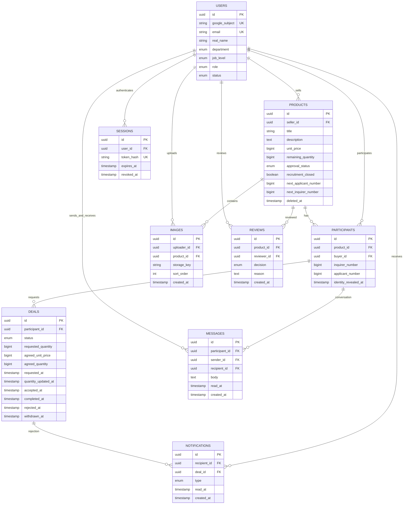

# ERD 초안

작성일: 2026-11-04. [PRD](prd.md)의 논리 모델. SQLite·Go를 사용한다. ‘제안’은 미확정 선택이다.

## 관계

## 필드와 제약

시각은 UTC 저장·ISO 8601 전달, 화면은 이용자 시간대로 표시한다. 모든 테이블은 id PK를 가진다. users·products·participants·deals에는 created_at·updated_at도 둔다.

### users — 재직자

| 필드 | 의미·제약 |
|---|---|
| google_subject | 검증된 구글 계정 식별자, nullable·고유. 개발 계정은 NULL |
| email | 검증된 사내 메일, 필수·고유. 상대에게 공개하지 않음 |
| real_name | 가입자 직접 입력, 필수 |
| department, job_level | 필수 enum. 회사가 실제 목록 정의 |
| role | `MEMBER`, `HR_ADMIN`. 관리자 권한은 가입자가 지정할 수 없음 |
| status | `ACTIVE`, `SUSPENDED`. 서비스 접근 통제용 제안 |

프로필 완성 전에는 짧은 가입용 세션을 쓰고, 가입 완료 시 users를 생성하는 것을 제안한다. 개인정보 변경 정책은 미정이다.

### products — 현재 상품

- seller_id: users FK, 필수.
- title·description: 필수. unit_price: 원화 정수, 0 이상. 상한 미정, 최소 1억 원 지원.
- remaining_quantity: 0 이상 정수. 등록 시 1 이상. 총 수량·단위·서비스 유형 필드는 두지 않는다.
- approval_status: `PENDING`, `APPROVED`, `REJECTED`.
- recruitment_closed: 기본 false. 수량 소진과 별도 조건이다.
- next_applicant_number·next_inquirer_number: 기본 1, 상품별 순번 원자적 배정용 내부 값.
- deleted_at: nullable. 숨김 후에도 쪽지·거래 FK를 유지한다.
- 공개 조건: APPROVED이며 deleted_at이 null. 새 신청은 추가로 모집 중·잔여 수량 충분·본인 상품 아님 조건을 검증한다.

### participants — 상품별 익명·대화 연결

- `(product_id, buyer_id)` 고유. 한 상품의 같은 구매자 문의·반복 신청을 연결한다.
- inquirer_number: 최초 문의 시 배정, nullable. 상품 내 값이 있는 번호끼리 고유.
- applicant_number: 최초 신청 시 배정, nullable. 상품 내 값이 있는 번호끼리 고유.
- 둘 중 하나 이상은 존재한다. 문의 번호는 A, B, …, AA로 표시하고 신청 번호는 ‘익명 1’처럼 표시한다.
- **제안:** 재신청해도 기존 신청 별칭을 유지하고 순번은 재사용하지 않는다.
- identity_revealed_at: 최초 수락 시각. 같은 상품의 해당 두 사람에게만 공개된 상태를 나타내는 제안이다.
- 별도 대화방 테이블 없이 participant를 1:1 대화방으로 사용한다. 외부 conversationId는 이 상품 범위의 불투명 ID이며 전역 buyer_id를 노출하지 않는다.

### deals — 신청·성사·완료

- participant_id: 필수 FK. 상품·구매자는 participant에서, 판매자는 product에서 찾는다.
- status: `REQUESTED`, `WITHDRAWN`, `REJECTED`, `ACCEPTED`, `COMPLETED`.
- requested_quantity: 양의 정수. REQUESTED 동안만 구매자가 변경 가능.
- agreed_unit_price·agreed_quantity: REQUESTED·WITHDRAWN·REJECTED는 null. ACCEPTED·COMPLETED는 각각 0 이상·양의 정수, 변경 불가.
- 수락 시 현재 상품 단가와 최신 신청 수량을 확정 필드에 복사한다. 합계는 계산값이다.
- requested_at: 최초 신청. quantity_updated_at: 실제 신청 수량 수정 시각, nullable.
- accepted_at·completed_at·rejected_at·withdrawn_at: 해당 전이 시각. 수락 후 취소 필드 없음.
- 상품 제목·본문·사진·신청 당시 가격 스냅샷 없음.
- **제안:** participant당 REQUESTED·ACCEPTED 합쳐서 한 건. 조건부 고유 인덱스 또는 동등한 잠금·제약으로 보장한다.
- 상태별 확정 필드·시각 null 여부를 검증한다. COMPLETED는 accepted_at·completed_at 모두 필수다.

### messages — 쪽지

- participant_id는 대화, sender_id·recipient_id는 users FK다.
- 송수신자는 해당 상품의 판매자와 해당 participant 구매자여야 한다. 수신자는 서버가 결정한다.
- body: 필수 텍스트. 텍스트만 지원하는 것은 제안이다.
- read_at: 수신자가 읽음 처리한 시각, nullable. 발신자는 변경 불가.
- created_at: 필수. 수정·삭제 기능은 초안에 없다.
- 안 읽은 쪽지는 recipient_id와 read_at으로 조회한다. users에 중복 카운터를 두지 않는 것을 제안한다.
- idempotency_key: 발송 재시도 키, nullable(migration `00005`, #19). `(participant_id, sender_id, idempotency_key)` 부분 고유 인덱스. 보관 기간은 쪽지를 따른다([결정 기록](decisions/anonymous-messages.md)).
- created_at은 대화 안에서 엄격히 증가하도록 저장한다(읽음 처리 경계 보장).

### images / reviews

- images: uploader_id는 업로드 소유권 검증, product_id는 상품 연결 전 null 허용, storage_key는 고유, sort_order는 상품 내 표시 순서다. 원본 파일명·EXIF·스토리지 경로에 신원이 노출되지 않게 처리한다. 미연결 이미지 정리 기간·사진 제한은 미정이다.
- reviews: product_id·reviewer_id FK. decision은 APPROVED 또는 REJECTED. 반려 사유 필수. 심사 결과만 기록하며 상품 정보의 버전·복사본을 저장하지 않는다.
- 승인·반려는 PENDING에서만 허용한다. 반려 후 재요청 시 product를 PENDING으로 변경한다.

### notifications / sessions

- notifications: recipient_id·deal_id FK, type은 `APPLICATION_REJECTED`. `(deal_id, type)` 고유로 중복 알림 방지. read_at nullable. 앱 내 알림함을 사용한다.
- 알림은 현재 상품·거래를 참조하며 상품 제목 스냅샷은 저장하지 않는다.
- sessions: 고정 만료 서버 세션. csrf_token·created_at을 추가하고 원본 세션 토큰 대신 SHA-256 해시만 저장한다. 원본 토큰 대신 해시 저장, 만료·회수 시각 유지. 구글 계정 정지 감지·로컬 세션 회수 방식은 미정이다.

## 트랜잭션과 경합

1. 신청: 상품 잠금 → 공개·모집·수량·중복 검사 → participant 및 별칭 배정 → REQUESTED 생성. 수량 차감 없음.
2. 수락: 상품 → participant → deal 순 잠금 → 판매자·REQUESTED·잔여 수량 검증 → 수량 차감·단가/수량 확정·ACCEPTED·신원 공개를 함께 커밋.
3. 상품 수정: 상품 잠금 → 대기 신청 검사 → 명시적 일괄 거절 옵션이면 REQUESTED 모두 거절·알림 생성 → 수정까지 함께 커밋. 새 신청도 같은 상품 잠금을 사용한다.
4. 신청 수량 수정: 동일 잠금 순서에서 REQUESTED 및 현재 잔여 수량 검증. 수락이 먼저 끝났으면 수정 거절.
5. 완료: 판매자·ACCEPTED 확인 후 COMPLETED. 재고 추가 차감·복원 없음.
6. 수량 조정·승인·숨김도 상품 잠금으로 신청·수락과 순서를 정한다. 모든 경로에서 잠금 순서를 일관되게 유지한다.

동일 전이 재요청으로 차감·알림이 중복되지 않도록 상태를 검사한다. 신청 생성·쪽지 발송의 네트워크 재시도는 멱등키 저장소 사용을 제안하며 실제 저장소·보관 기간은 미정이다.

## 인덱스·접근 통제

- products: `(approval_status, deleted_at, created_at)`, `(seller_id, created_at)`.
- participants: 상품·구매자 고유, 상품별 별칭 번호 고유.
- deals: `(participant_id, status)` 및 진행 중 거래 고유 제약.
- messages: `(participant_id, created_at, id)`, `(recipient_id, read_at)`, `(participant_id, sender_id, idempotency_key)` 부분 고유.
- notifications: `(recipient_id, read_at, created_at)`, 거래·유형 고유.
- reviews: `(product_id, created_at)`.
- 익명 DTO에 상대의 전역 사용자 ID·구글 ID·이메일을 포함하지 않는다. 신원 공개는 거래 관계 또는 HR_ADMIN 권한을 매번 확인한다. UUID를 아는 것만으로 접근할 수 없다.

## 인사팀 기간별 집계

추가 통계 테이블은 두지 않는다. `deals(status, completed_at)` 인덱스를 추가하고 COMPLETED 및 완료 기간을 조건으로 `SUM(agreed_unit_price * agreed_quantity)`, `COUNT(*)`를 조회한다. 빈 결과 SUM은 0으로 반환한다. 완료된 거래의 확정 필드를 사용하므로 상품 수정·숨김이 합계에 영향을 주지 않는다. 날짜 경계는 API에서 Asia/Seoul 기준 UTC 구간으로 변환한다.

수량 조정은 대기 신청을 거절하지 않는다. 조정 후 수량이 기존 신청보다 적어도 신청은 유지하며 수락 단계에서 차단한다.

SQLite 단일 프로세스·짧은 트랜잭션으로 구현한다. 위 상품 잠금은 논리적 직렬화 요구사항이며 SQLite에 SELECT FOR UPDATE를 사용하지 않는다. 쓰기 트랜잭션과 조건부 UPDATE·제약으로 수락·수정·신청 경합을 처리한다. [기술 스택](tech-stack.md)을 따른다.

## 가입 승인 확장 (#31)

- departments(id PK, name UNIQUE, is_hr). 최초 `hr / 인사팀` 하나이며 is_hr=1은 최대 하나, 관리자 부서 삭제 금지.
- users.department_id → departments.id, nullable(기존 개발 fixture 호환). 표시용 department는 부서 이름 변경과 같은 트랜잭션으로 동기화한다.
- users.membership_status: PROFILE_REQUIRED / PENDING / ACTIVE / REJECTED. 기존 계정은 ACTIVE, Google 신규 계정은 PROFILE_REQUIRED. 기존 status(ACTIVE/SUSPENDED)는 이용 정지를 독립 관리한다.
- users.reviewed_at, reviewed_by → users.id: 가입 심사 시각·담당자. 최초 운영 승인만 reviewed_by=NULL이다.
- oauth_flows(state_hash PK, binding_hash, nonce, verifier, expires_at): 10분 만료·일회용 로그인 흐름. Google 액세스/리프레시/ID 토큰은 저장하지 않는다.

가입 소속 선택은 승인 전 관리자 권한을 부여하지 않는다. 승인 시 해당 부서의 is_hr가 참일 때만 HR_ADMIN을 부여한다.
